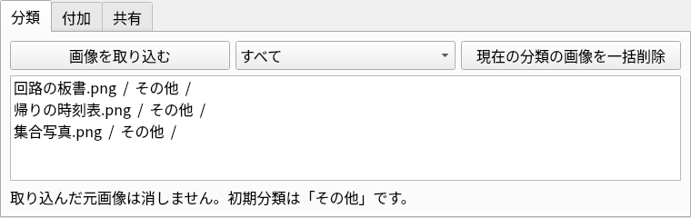

# 2　起動とイベント｜誰が次の関数を呼ぶか

[第1章の配置図](../index.md)で見た四つのファイルのうち、この章で開くのは `__main__.py` と `ui/main_window.py` です。ウィンドウを開く前に一度だけ通る処理と、表示した後で何度も呼ばれる処理を、実行順に読んでみましょう。

## 普通の関数呼び出しとして起動を読む

```python
def main() -> int:
    app = QApplication(sys.argv)
    window = MainWindow()
    window.show()
    return app.exec()
```

`sys.argv` は起動時の引数のリストです。二行目の代入でQtアプリができ、次の `MainWindow()` ではウィンドウの初期化が最後まで進みます。`window` に結果が入る時点で、データベースの最初の読み出しも済んでいます。順序を決めているのは `MainWindow.__init__` の末尾にある `self.refresh()` です。`show()` を呼んでから `app.exec()` に入ると、Qtがクリックや終了操作を待ちながら対応する関数を呼びます。待機が終わって初めて `main` は終了コードを返し、入口の `raise SystemExit(main())` がそれをプロセスの終了に使います。[入口](https://github.com/OsakanaHEAVEN/Create_Engineering_F/blob/e7dbd20b3e581878729673e2cd82ea60719336e4/src/imagebox/__main__.py#L9-L17)・[ウィンドウの初期化](https://github.com/OsakanaHEAVEN/Create_Engineering_F/blob/e7dbd20b3e581878729673e2cd82ea60719336e4/src/imagebox/ui/main_window.py#L22-L40)



## クリックと関数をつなぐ一行

```python
add.clicked.connect(self.add_image)
```

`add` は「画像を取り込む」ボタンです。括弧の中をよく見ると `self.add_image` の末尾には `()` がありません。ここでボタンに渡すのは「このウィンドウの `add_image` を後で呼べる値」です。これを呼び出すきっかけになるQtの通知を**シグナル**と呼びます。もし `self.add_image()` と書けば、ボタンを作っている最中にファイル選択が始まり、`connect` にはその実行結果の `None` が渡ってしまいます。[ボタンを作る場所](https://github.com/OsakanaHEAVEN/Create_Engineering_F/blob/e7dbd20b3e581878729673e2cd82ea60719336e4/src/imagebox/ui/main_window.py#L42-L62)

## `board.png` を選んだときに渡るもの

| 呼ぶ側 → 呼ばれる側 | 渡すもの | 戻った後、呼んだ側はどうするか |
|---|---|---|
| Qt → `MainWindow.add_image` | クリックの通知。このメソッドにファイル名の引数はない | メソッド内でファイル選択を開く |
| `add_image → QFileDialog.getOpenFileNames` | 親ウィンドウ、タイトル、初期フォルダ、選択条件 | 結果の組を `paths, _` に分ける。`paths` は選んだファイル名のリスト、`_` に入る選択フィルタは使わない |
| `add_image → self.repo.import_file` | リストから取り出した文字列を `Path(name)` にしたもの | 戻り値は一枚分の記録。`add_image` は変数に代入せず、次のファイルを処理する |
| `add_image → self.refresh` | 引数なし。画面の選択状態を `self` 経由で読む | 一覧を消し、`self.repo.list_images(category)` が返した記録から各行を描き直す |

キャンセルなら `paths` は空で、保存関数は一度も呼ばれません。それでもループの下の `refresh()` は一度呼ばれます。二枚選び、一枚目が画像として読めず `ValueError` になった場合は、`errors` に理由をためて二枚目へ進みます。最後に一覧を更新し、失敗理由をまとめて表示します。`sqlite3.Error` はこの `except (ValueError, OSError)` の対象外なので、同じ経路で警告されるとは限りません。[取り込みと一覧更新](https://github.com/OsakanaHEAVEN/Create_Engineering_F/blob/e7dbd20b3e581878729673e2cd82ea60719336e4/src/imagebox/ui/main_window.py#L64-L84)

## 接続を閉じるのは誰か

ウィンドウを閉じると、Qtは `MainWindow.closeEvent(self, event)` を呼びます。画面は `self.repo.close()` を呼び、保存担当が自分の接続を `self.conn.close()` で閉じます。その後で画面は親クラスに終了イベントを渡します。`self.repo` を持つ側と `self.conn` を持つ側の区別が、終了時にもそのまま現れます。[画面の終了処理](https://github.com/OsakanaHEAVEN/Create_Engineering_F/blob/e7dbd20b3e581878729673e2cd82ea60719336e4/src/imagebox/ui/main_window.py#L107)・[接続を閉じるメソッド](https://github.com/OsakanaHEAVEN/Create_Engineering_F/blob/e7dbd20b3e581878729673e2cd82ea60719336e4/src/imagebox/core/repository.py#L41-L42)

[Pythonがこの入口を見つける仕組み](../lessons/01-python.md)・[Qtの起動を手元で観察する](../lessons/02-boot.md)

[前へ　1　技術概論](../index.md)　·　[次へ　3　一枚の画像とSQLite](remember.md)
