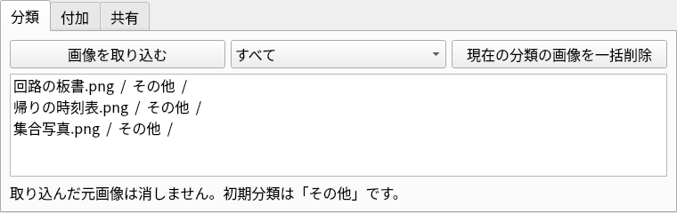

# 1　概論｜写真を撮った後に、何をしたいか

放課後、スマホのアルバムに三枚の写真が並んでいます。一枚は黒板に描かれた回路図。一枚は帰りのバスの時刻表。もう一枚は友人との集合写真です。その日はどれを何のために撮ったか覚えています。ところが試験前に「コンデンサの充電を説明していた板書」を探す頃には、撮った日もファイル名も思い出せません。時刻表はもう用済みで、集合写真は何年先も残しておきたい。撮る操作は同じでも、その後の使い道はずいぶん違います。

**Create Engineering F の出発点は、写真を撮った理由が、アルバムに入った途端に見えなくなることです。** この講義では、撮影した人が後で写真を探し出し、必要なら友人に渡せるようにするには、コンピュータに何を覚えてもらえばよいかを考えます。

## 一枚の板書を、翌週まで追ってみる

授業の終わり、葵さんが「来週のレポートで使う、充電のグラフ」と言って黒板を撮ります。写真にはグラフが写りますが、「レポートで使う」は写りません。そこで製品の設計では、撮影直前の短い音声を、許可を得て写真に対応付けます。写真とその言葉がそろえば、「回路の板書」という説明に「復習用の資料」という手掛かりを加えられます。逆にマイクが使えない日でも、黒板そのものは残したいですね。この順で考えると、**写真の保存**と**説明を後から付ける仕事**を分ける理由が見えてきます。

翌週、葵さんは「充電」で写真を探します。同級生の蓮さんもその板書が欲しいのですが、葵さんのアルバムには私的な写真もあります。設計では、蓮さんが欲しい内容を文章で頼み、葵さんの端末で候補を探します。最後に葵さんが選び、承認した写真だけが相手に届きます。「見つかること」と「渡してよいこと」には、それぞれ別の判断が要るわけです。

## この体験は、なぜ実現できるのか

| したいこと | 最低限、覚えておくもの | それで何ができるか |
|---|---|---|
| 明日も同じ板書を開く | 写真のファイルと、その保存場所を記した記録 | アプリを閉じても、次に同じ写真を見つけられる |
| 「充電」で探す | 写真に結び付けた説明や文字起こし | ファイル名に「充電」がなくても、記録に含まれる言葉を照合できる |
| 用途ごとに整理する | 写真の識別番号と「メモ・資料」などの用途 | 分類を変えるたびに画像を複製せず、一覧の見せ方を変えられる |
| 特定の友人に渡す | 誰から誰への依頼か、どの写真を承認したかの記録 | 依頼した本人に、承認済みの写真を取り出せるようにできる |

ここでいう「記録」は、たとえば「写真番号17の保存場所はここ、説明は『充電のグラフ』」という一行です。17は説明用の仮番号です。実際のアプリはもっと長い番号を作ります。今は番号の作り方よりも、**写真・説明・用途を同じ一枚のものとして扱うために番号がある**、と捉えてください。

## 今日のアプリを開くと、どこまで見えるか

下は、調査した版のアプリに教材用の三枚を取り込んだ実際の画面です。「分類」タブにはファイル名が並び、初期の分類は三枚とも「その他」です。回路も時刻表も自動では見分けていません。ここまでが、通常起動でそのまま観察できる範囲です。

一方、直前の音声を取り出す処理や、画像をAIに渡して説明を受け取る処理には、単独で呼べるコードがあります。開発中には、データを一時的に記憶する代役を使って、保存から分類までの受け渡しも確かめています。この代役を **Fake** と呼びます。通常画面の「付加」「共有」はまだ案内表示で、先ほどの葵さんと蓮さんの体験が丸ごと動く段階には至っていません。[製品が目指す体験](https://github.com/OsakanaHEAVEN/Create_Engineering_F/blob/e7dbd20b3e581878729673e2cd82ea60719336e4/docs/PROJECT_SPEC.md) · [現在の画面を組み立てるコード](https://github.com/OsakanaHEAVEN/Create_Engineering_F/blob/e7dbd20b3e581878729673e2cd82ea60719336e4/src/imagebox/ui/main_window.py)

## ここからの読み順

最初に、アプリを閉じても写真が残る仕組みを見ます。その知識があると、ボタンを押したときに「どの記録を増やすのか」が分かります。後半では、その記録に意味を足す方法、処理の順番が前後しても一枚を取り違えない方法、ほかの人に渡す条件の順に進みます。各章は結果まで載せた例で読めます。手元で同じ動きを確かめたいときだけ、章末から実装ノートを開いてください。

[2　写真を覚える](course/remember.md)　／　[3　ボタンから処理へ](course/operate.md)　／　[4　写真に意味を付ける](course/meaning.md)　／　[5　時間と失敗を扱う](course/time.md)　／　[6　人と人の間で渡す](course/share.md)

---

[次へ　2　写真を覚える](course/remember.md)
