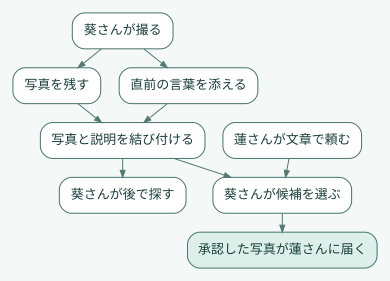

# 1　技術概論｜プログラムはどこで組み立てられるか

`python -m imagebox` でアプリを起動すると、誰がデータベースを開くのでしょう。入口の `main()` はたった数行で、SQLもファイル名も出てきません。そこにあるのは `window = MainWindow()` です。開く先を決めるには、この一行から二つのファイルをたどります。

## 最初に開く四つのファイル

下の図では矢印のそばに**実際に渡すもの**を書きました。`src/imagebox/` が本体の起点です。`ui/` には画面に属する処理、`core/` には画面を開かなくても使える型と保存処理があります。

| 読む順 | ファイル | そこで確かめられること |
|---|---|---|
| 1 | [__main__.py](https://github.com/OsakanaHEAVEN/Create_Engineering_F/blob/e7dbd20b3e581878729673e2cd82ea60719336e4/src/imagebox/__main__.py#L9-L17) | `main()` がQtアプリとウィンドウを作る。ウィンドウの生成が済んでから表示する |
| 2 | [ui/main_window.py](https://github.com/OsakanaHEAVEN/Create_Engineering_F/blob/e7dbd20b3e581878729673e2cd82ea60719336e4/src/imagebox/ui/main_window.py#L18-L33) | `MainWindow.__init__` の `self.repo = ImageRepository()` が、画面が使う保存担当を決める |
| 3 | [core/repository.py](https://github.com/OsakanaHEAVEN/Create_Engineering_F/blob/e7dbd20b3e581878729673e2cd82ea60719336e4/src/imagebox/core/repository.py#L18-L42) | `ImageRepository.__init__` が保存場所を選び、画像用フォルダとSQLite接続を用意する。接続を保持する変数は `self.conn` |
| 4 | [core/models.py](https://github.com/OsakanaHEAVEN/Create_Engineering_F/blob/e7dbd20b3e581878729673e2cd82ea60719336e4/src/imagebox/core/models.py#L16-L28) | `ImageRecord` が一枚分の項目を定める。`original_name` は表示に使う名前、`stored_path` は管理コピーを開くための場所 |

ここで `self` は「今このメソッドが操作している実体」です。画面の `self.repo` と保存担当の `self.conn` は持ち主が違います。取り込みと再表示で同じデータベースを使えるのは、ウィンドウが最初に作った保存担当をずっと持っているからです。

## 同じリポジトリにある、別の実行経路

次に `core/contracts.py` を開くと、もう一つの `ImageRecord` が見つかります。こちらには `stored_relpath` や `annotation_revision` があります。起動画面がどちらを使っているかは、名前から推測せず、**その値を作るファイルの `import`** で確かめられます。`core/repository.py` の取込元は `imagebox.core.models`、`dev/fakes.py` の取込元は `imagebox.core.contracts` です。

| どこから実行するか | 呼び出しが届く先 | 実際に起こること |
|---|---|---|
| 通常起動の「画像を取り込む」 | `MainWindow.add_image → ImageRepository.import_file` | 選んだ画像をコピーし、SQLiteへ一行書く |
| [契約を確かめるテスト](https://github.com/OsakanaHEAVEN/Create_Engineering_F/blob/e7dbd20b3e581878729673e2cd82ea60719336e4/tests/test_contract_bootstrap.py#L46-L86) | `FakeRepository.register_capture → _add → enqueue_job` | 画像の寸法を読み、Pythonの辞書に記録とジョブを作る。テスト自身が次の処理を呼ぶ |
| [Gemini部品の個別起動](https://github.com/OsakanaHEAVEN/Create_Engineering_F/blob/e7dbd20b3e581878729673e2cd82ea60719336e4/src/imagebox/augmentation/service.py#L96) | `GeminiVisionProvider.annotate → _parse_annotation` | 同意・キーなどの条件がそろえば画像を送信し、応答を一つの `Annotation` にまとめる |
| [共有の設計](https://github.com/OsakanaHEAVEN/Create_Engineering_F/blob/e7dbd20b3e581878729673e2cd82ea60719336e4/docs/sharing/API_DESIGN.md) | `SharingClientPort.approve` などの契約 | 複数枚の承認から受信までの取り決め。通常起動の共有タブにこの経路を呼ぶコードはまだない |

## この講義でコードを読む順序

まず[第2章](course/operate.md)で、ウィンドウができてからクリックが関数に届くまでを読みます。[第3章](course/remember.md)では一枚のPNGを使い、同じ写真がパス、Pythonのオブジェクト、SQLの一行、表示用の文字列に姿を変えるところを確かめます。この二章で、通常起動するアプリの呼び出しを端から端までたどれます。

その上で[第4章](course/meaning.md)では新しいデータ型とAIの戻り値、[第5章](course/time.md)では一回の呼び出しで完結しない処理、[第6章](course/share.md)では検索・共有を例に型を変えたときの影響を扱います。ファイル名から探したいときは[全Pythonファイルの地図](reference/files.md)、関数名から探したいときは[関数の読解索引](reference/code.md)を使えます。[調査した版と実装状況](reference/audit.md)

[次へ　2　起動とイベント](course/operate.md)
