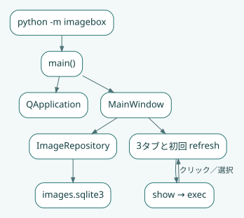

# Qtの起動から最初の一覧まで

[本編に戻る　3　ボタンから処理へ](../course/operate.md)

操作する前からデータベースが開いているのはなぜでしょう。ここでは、ウィンドウを作る途中で起きたことを時刻順にたどります。

## 一度だけ組み立て、あとは入力を待つ

`QApplication` はウィンドウシステムとの窓口。`QMainWindow` を継承した `MainWindow` は、基本の表示・終了操作を引き継ぎ、初期化と終了時の後始末を加える。`super().__init__()` で親の初期化を先に済ませる。イベントループを受付係にたとえると、クリックは届いた依頼、スロットは担当者の処理である。ただし同じGUIスレッドで担当者が長時間働くと、受付も次の描画や入力を処理できない。

| 時点 | 関数・式 | 値と副作用 |
|---|---|---|
| 1 | `QApplication(sys.argv)` | 引数一覧をQtへ渡し、アプリ実体を `app` に束縛 |
| 2 | `window = MainWindow()` | 初期化中に `self.repo = ImageRepository()`。`images/` を作り、SQLite接続と `images` 表を用意 |
| 3 | `_classification_tab()` | `すべて` に付随する値は `None`。5分類には内部キーを持たせ、ボタンとフィルタのシグナルにメソッドを接続 |
| 4 | `_placeholder()` を2回、`setCentralWidget`、`refresh()` | 「付加」「共有」は文章。分類一覧を消してSQLの結果から作り直す。初回0件なら表示も0件 |
| 5 | `window.show()` → `app.exec()` | 表示を要求し、イベントループに入る。showの直後にmainの実行が終わるわけではない |
| 6 | `closeEvent` → `repo.close()` → 親の終了処理 | 通常は最後のウィンドウを閉じるとループが戻り、その整数が `SystemExit` の終了コードになる |

`connect(self.add_image)` の引数は呼び出せるオブジェクトである。末尾に括弧を付けると、組み立て中に呼び出してしまう。フィルタ変更なら `refresh` が `currentData()` からキーを読み直す。`QListWidget` の表示はレコードを文字列化した結果で、DBへの生きた参照ではない。[MainWindow](https://github.com/OsakanaHEAVEN/Create_Engineering_F/blob/e7dbd20b3e581878729673e2cd82ea60719336e4/src/imagebox/ui/main_window.py#L22-L110) [main](https://github.com/OsakanaHEAVEN/Create_Engineering_F/blob/e7dbd20b3e581878729673e2cd82ea60719336e4/src/imagebox/__main__.py#L9-L13)

## 値を見て確かめる

GUIで実験する場合は専用の `IMAGEBOX_DATA_DIR` を指定する。`.env.example` を眺めるだけでは値は設定されない。`os.getenv` は今のプロセスの環境を読む。空白を取り除いて空なら `Path.home() / "Pictures" / "CreateEngineeringF"`。`Path / "images"` の `/` はパス部品の結合である。[default_data_dir](https://github.com/OsakanaHEAVEN/Create_Engineering_F/blob/e7dbd20b3e581878729673e2cd82ea60719336e4/src/imagebox/core/repository.py#L18-L20)

[起動実験 boot.py](../labs/boot.py) は一時フォルダを設定し、実物の `main()` を呼ぶ。表示直後にタイマーで検査を予約し、イベントループの中でタブ名と件数を読み、閉じる。観測値は `['分類', '付加', '共有'] 0`。ディスプレイを使わないQtモードで、この実験はカメラ・モデルの起動を要求しない。

### 画像がないのにSQLiteファイルがある。どの関数で作られたか。

MainWindow の初期化が ImageRepository の初期化を呼び、sqlite3.connect が指定先を開く。存在しなければファイルができ、CREATE TABLE が続く。クリックの有無は関係しない。

### 保存先のディレクトリを作る権限がないと、どの段階まで進むか。

images_dir.mkdir の例外をこの初期化経路は捕捉しない。MainWindow() の評価が終わらず、show に達しない。強制終了の場合も通常の closeEvent を通る保証はない。

---

[前へ　Pythonの実行入口](01-python.md)　·　[次へ　契約とFake](04-contract.md)　·　[概論へ](../index.md)
