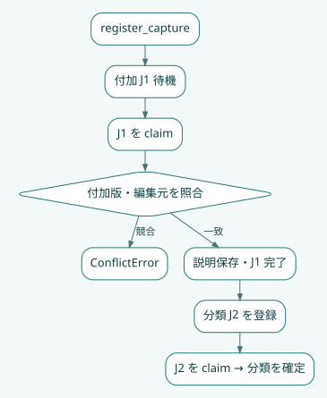

# 7　一枚分の仕事を、途中からやり直せる形にする

**到達点**　画像行とジョブ行を別々に追い、同時実行・手動編集・異常終了で守る条件を説明する。第4講と第6講の戻り値を使う。

## 待ち時間をどこに置くか

窓口が全員の現像を終えるまで次の依頼を受けられないと、操作が止まる。キューは未処理の依頼票、ワーカーは票を引き取る実行者。実行者を別スレッドにすることでGUIへ制御を返せる。依頼票をDBに残せばプロセスが終了した後も読み直せる。この二つは別問題であり、スレッドを増やしても永続化は得られない。

Qtの独立例では、`Worker(QObject)` を `moveToThread` して `thread.started` を `run` へ接続する。`done(str)` はGUI側のラベル更新と `quit` へ、`finished` は後始末へつなぐ。スレッドをまたぐ通常の自動接続では受信側のイベントループに処理が届く。`run()` をGUI側から直接呼べばこの分離は起きない。実行中は終了要求を拒む例で、ネットワークのキャンセルや永続ジョブの停止手順は別途必要。実DBでは接続をワーカースレッドごとに開く設計である。[examples/help/qthread.py](https://github.com/OsakanaHEAVEN/Create_Engineering_F/blob/e7dbd20b3e581878729673e2cd82ea60719336e4/examples/help/qthread.py) [docs/CONTRACTS.md](https://github.com/OsakanaHEAVEN/Create_Engineering_F/blob/e7dbd20b3e581878729673e2cd82ea60719336e4/docs/CONTRACTS.md)

## Fakeで追う二段階の処理



`P` は画像ID、`J1/J2` は独立したジョブID。`generation` は再処理の世代、`revision` は画像の編集競合を検出する版。以下は**実際のFake**の状態表である。画像の状態とジョブの状態が異なる瞬間に注目する。[FakeRepository.claim_job](https://github.com/OsakanaHEAVEN/Create_Engineering_F/blob/e7dbd20b3e581878729673e2cd82ea60719336e4/src/imagebox/dev/fakes.py#L265-L270) [FakeRepository.complete_annotation_job](https://github.com/OsakanaHEAVEN/Create_Engineering_F/blob/e7dbd20b3e581878729673e2cd82ea60719336e4/src/imagebox/dev/fakes.py#L272-L282)

| 呼出直後 | J1 / J2 | Pの付加 / 分類 | 付加版 / 分類版 / 行版 |
|---|---|---|---|
| `register_capture` | pending / なし | pending / waiting_annotation | 0 / 0 / 0 |
| `claim_job("annotation", t)` | processing / なし | pending / waiting_annotation | 0 / 0 / 0 |
| `complete_annotation_job` | completed / pending | completed / pending | 1 / 0 / 2 |
| `claim_job("classification", t)` | completed / processing | completed / pending | 1 / 0 / 2 |
| `complete_classification_job` | completed / completed | completed / completed | 1 / 1 / 4 |

行版が2増える理由は、説明値の `_write` と状態の `_write` が別々に呼ばれるため。`claim_job` は辞書内のジョブを更新し、そのコピーを返す。呼出側がコピーを書き換えても内部の状態は変わらない。`now_utc` による予定時刻判定は実装されていない。

[実験ファイル　fake_trace.py](../labs/fake_trace.py)

```python
"""同じ実物のFakeRepositoryを最後まで使い、状態を観測する。"""
from pathlib import Path
from tempfile import TemporaryDirectory

from PIL import Image
from imagebox.core.contracts import Annotation, CaptureInput, ConflictError, SearchQuery
from imagebox.dev.fakes import FakeClassificationProvider, FakeRepository, FakeVisionProvider

with TemporaryDirectory() as tmp:
    path = Path(tmp) / "board.png"
    Image.new("RGB", (32, 24)).save(path)
    repo = FakeRepository()
    t = "2026-11-18T01:00:00Z"
    shot = CaptureInput(str(path), None, t, "1" * 32, 1)
    row = repo.register_capture(shot)
    job = repo.claim_job("annotation", t)
    assert job and job["image_id"] == row.id
    auto = FakeVisionProvider().annotate(str(path), "復習用")
    annotated = repo.complete_annotation_job(job["id"], auto, 0)
    cat = repo.create_category("授業", "復習する資料")
    next_job = repo.claim_job("classification", t)
    selected = FakeClassificationProvider().classify(auto, repo.list_categories())
    result = repo.complete_classification_job(next_job["id"], selected, 0)
    print(row.category_id, annotated.annotation_revision, result.category_id == cat.id)
    assert [r.id for r in repo.list_images(SearchQuery(text="ＲＣ 板書"))] == [row.id]
    edit = Annotation("抵抗とコンデンサ", ["授業"], "", "manual", None, "manual")
    manual = repo.save_annotation(row.id, edit, annotated.annotation_revision, "manual")
    try:
        repo.save_annotation(row.id, auto, manual.annotation_revision, "ai")
    except ConflictError:
        print("手動値を保持", repo.get_image(row.id).caption)
    else:
        raise AssertionError("手動保護の消失")
    repo.trash_images([row.id])
    assert repo.list_images(SearchQuery()) == []
    repo.restore_images([row.id])
    assert repo.get_image(row.id).id == row.id
    repo.trash_images([row.id])
    repo.purge_images([row.id])
    assert path.exists() and not repo.jobs
```

実行時のUUIDは毎回変わる。1行目の `None 1 True` は「登録直後のレコードが未分類」「付加後は版1」「分類結果が作成した授業カテゴリを指す」の順。最後に元入力PNGが存在するのは、Fakeのpurgeが辞書だけを掃除するためである。

### 古いAI応答が到着する

AIが付加版0を読んで外部処理を始める。人が版0を指定して手動保存すると新しい版は1。AIが版0で戻れば不一致で `ConflictError`。たとえ版1を読み直しても、現在の `annotation_source="manual"` かつ書込元がAIなら拒む。`category_revision` が独立しているので無関係なカテゴリ編集を付加版の競合と誤認せずに済む。Fakeのチェックと書込みを、複数プロセス間の排他として使うことはできない。

## 原子性をSQLiteで実験する

付加の完了だけコミットして分類登録前に停止したら、誰も次の処理を拾えない。次の縮小模型は二つのSQLを同じトランザクションに入れ、間に例外を挟む。実アプリの `jobs` 実装はこのSHAでは予定である。[docs/DATA_SCHEMA.md](https://github.com/OsakanaHEAVEN/Create_Engineering_F/blob/e7dbd20b3e581878729673e2cd82ea60719336e4/docs/DATA_SCHEMA.md) [SQLiteのトランザクション](https://www.sqlite.org/lang_transaction.html)

[実験ファイル　atomic.py](../labs/atomic.py)

```python
"""教材用の縮小DB。例外を挟んでも、完了と次段登録は一組になるか。"""
import sqlite3

db = sqlite3.connect(":memory:")
db.execute("CREATE TABLE jobs(stage TEXT PRIMARY KEY, status TEXT NOT NULL)")
with db:
    db.execute("INSERT INTO jobs VALUES ('annotation','processing')")


def complete(fail: bool) -> None:
    with db:
        changed = db.execute(
            "UPDATE jobs SET status='completed' WHERE stage='annotation' AND status='processing'"
        ).rowcount
        if changed != 1:
            raise ValueError("すでに確定したジョブ")
        if fail:
            raise RuntimeError("二つの書込みの間で失敗")
        db.execute("INSERT INTO jobs VALUES ('classification','pending')")


try:
    complete(True)
except RuntimeError:
    print(db.execute("SELECT * FROM jobs").fetchall())
complete(False)
rows = db.execute("SELECT * FROM jobs ORDER BY stage").fetchall()
print(rows)
assert rows == [("annotation", "completed"), ("classification", "pending")]
db.close()
```

最初の出力は `[('annotation', 'processing')]`。例外がwithの外へ抜け、完了状態の変更も戻った。再実行ではcompletedと次段pendingがそろう。本番では画像ID・段階・世代の一意性、条件付きのclaim、予定時刻、試行回数、起動時のprocessing回収を組み合わせる。ファイルや外部API料金はSQLのrollbackの対象外。API成功直後・結果保存直前に落ちれば、DBの二重登録防止だけで外部リクエストの厳密な一回性までは証明できない。

<details markdown="1">
<summary>Fakeのfinish_jobで未来のretry_at_utcとpendingを指定した。直後のclaimは待つか。</summary>

待たない。finish_jobは値を保存するがclaimの条件はstageとpendingだけ。順番を再現するテストで時刻制御まで証明したことにはならない。

</details>

<details markdown="1">
<summary>競合でcomplete_annotation_jobが例外になったら、Fakeが自動的にJ1をfailedにするか。</summary>

save_annotationの例外が先に伝わり、後続のcompleted更新や分類enqueueに達しない。自動後始末はない。上位が処理しなければJ1はprocessingに残る。

</details>

次は、得られたカテゴリと文章を、別々の検索条件から引く。

---

[前へ　6　AI付加](06-ai.md)　·　[次へ　8　分類・検索・ごみ箱](08-album.md)
