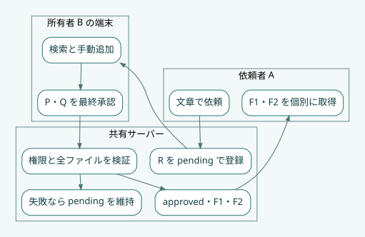

# 9　「候補に見えた」と「受信できる」の間にあるもの

**到達点**　HTTPの1往復を説明し、誰がどの端末で何を許可するか、2枚のうち1枚が失敗した場合に何が残るべきかを追う。第8講の検索、第7講の原子性が前提。

## 依頼票には写真を付けない

requesterは板書が欲しい人、ownerは写真を持つ人。依頼票に「RC回路の板書」と書かれていても、他人のアルバムを開く権利は生じない。受取窓口で本人を確認するのが**認証**、その本人がこの依頼の受取人かを確認するのが**認可**である。Bearerトークンは持っている人を本人として扱う秘密で、顔を見て本人確認できる窓口とは違う。HTTP本文のユーザー名だけで権限を決めない。

HTTPリクエストはメソッド、パス、ヘッダー、必要なら本文を持ち、サーバーがステータスと本文を返す。FastAPIは `@app.post(...)` 等の登録からリクエストをPython関数へ渡す。Uvicornはソケットで受けてアプリへ渡すサーバー、httpxは依頼を送るクライアント。`127.0.0.1` はそのコンピュータ自身を指す。[examples/help/fastapi_server.py](https://github.com/OsakanaHEAVEN/Create_Engineering_F/blob/e7dbd20b3e581878729673e2cd82ea60719336e4/examples/help/fastapi_server.py) [examples/help/httpx_client.py](https://github.com/OsakanaHEAVEN/Create_Engineering_F/blob/e7dbd20b3e581878729673e2cd82ea60719336e4/examples/help/httpx_client.py) [FastAPIの認証入門](https://fastapi.tiangolo.com/tutorial/security/first-steps/)

### 現在実行できる最小例

[実験ファイル　http_demo.py](../labs/http_demo.py)

```python
"""元リポジトリ直下を探索パスに加え、例示用FastAPIをプロセス内で呼ぶ。"""
from fastapi.testclient import TestClient
from examples.help.fastapi_server import app

with TestClient(app) as client:
    reply = client.post("/api/users", json={"username": "reader"})
    reply.raise_for_status()
    token = reply.json()["token"]
    me = client.get("/api/me", headers={"Authorization": f"Bearer {token}"})
    print(me.status_code, me.json()["id"])
    duplicate = client.post("/api/users", json={"username": "reader"})
    print(duplicate.status_code)
    assert me.json() == {"id": "reader"} and duplicate.status_code == 409
```

`POST /api/users` のJSONをFastAPIがRegistrationへ変換する。registerはトークンを生成しハッシュだけを辞書に保管。発行したトークンを次のAuthorizationヘッダーに入れると `GET /api/me` が本人のIDを返す。出力は `200 reader`、同じ名前で二度登録すると `409`。この例はTestClient経由で同一プロセス内に閉じる。実ポートへの送受信、ファイルのダウンロードは測定していない。独立例にあるのはhealth・登録・meで、製品の全ルートを持つ `sharing/api.py` は未実装である。

## 設計上のシーケンス　2枚を承認する



| 時点 | 操作とID | DB・ファイルの予定変化 |
|---|---|---|
| 1 | AがBをownerとして `POST /api/share-requests`。本文は `owner_user_id=B, query="RC回路"` | サーバーのshare_requestsに `R=(A,B,pending)`。写真0枚 |
| 2 | BがinboxからRを読み、B端末のSearchPortへ問い合わせ | ローカル候補P。候補外Qも手動で追加できる。サーバーに検索対象・候補一覧は渡らない |
| 3 | BがP・Qの2枚を確認。ID重複・trash・ファイルを再確認 | 送るコピーに向きを反映しメタデータを落とす。選択だけでは承認前 |
| 4 | BのBearerで `POST /api/share-requests/R/approve`。multipartの同名 `files` を2回 | サーバーで権限・pending・全ファイルを検証。temp→approved、行2件とRの承認済み状態を確定 |
| 5 | Aが `GET /api/share-requests/R/files` | サーバー発行の `F1,F2` を取得。B端末内の `P,Q` と異なるID |
| 6 | Aが各 `/api/share-requests/R/files/F1/download` 等を取得 | 依頼とファイルの所属・認可を確認し、それぞれのバイトをAの保存先へ書く |

JSONは依頼文やIDの構造に適する。multipartは境界で区切られた複数のパートを持ち、同名フィールドを繰り返して複数のバイナリを一要求で表現できる。ここで「一要求」は「全件成功」を保証しない。全件の検証、DBの条件付き更新、ファイルの補償・回復を組み合わせて初めて満たせる。HTTPクライアントが応答を受け取れず再送する場合も、既に承認済みならサーバー側で二重確定させない。[docs/sharing/API_DESIGN.md](https://github.com/OsakanaHEAVEN/Create_Engineering_F/blob/e7dbd20b3e581878729673e2cd82ea60719336e4/docs/sharing/API_DESIGN.md) [docs/sharing/SECURITY_TESTS.md](https://github.com/OsakanaHEAVEN/Create_Engineering_F/blob/e7dbd20b3e581878729673e2cd82ea60719336e4/docs/sharing/SECURITY_TESTS.md)

<details markdown="1">
<summary>AもBも有効なトークンを持つ。Aは自分が送ったRを承認できるか。</summary>

認証には成功してもownerはB。承認は拒否する。逆に取得はrequester Aに限定する。古いapproved_image_pathの集合検査だけでは、HTTP上の本人・依頼との対応は証明できない。

</details>

<details markdown="1">
<summary>2枚目を検証して画像として読めなかった。R、approved_files、ファイルの期待状態は？</summary>

Rはpending、確定行0、残留管理ファイル0。既に一時保存した1枚目も補償する。S09がこの一括失敗、S10が同時承認を検査する。どちらも現行GUIの合格実績ではない。

</details>

次は同じ写真を入口から順に追い、今どの経路を説明しているのかを自分で判定する。

---

[前へ　8　分類・検索・ごみ箱](08-album.md)　·　[次へ　10　統合追跡](10-trace.md)
