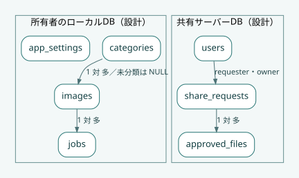

# すでに写真が入ったDBを移行する

[本編に戻る　3　一枚の画像とSQLite](../course/remember.md)

以前のアルバムに新しい項目を足したいとき、今まで保存した写真をどう引き継ぐかを、小さなデータベースで見てみましょう。

## なぜファイルを開くだけでは移行できないか

古い名簿に「学籍番号」が加わったら、見出しを書き足すだけでは過去の行は埋まらない。SQLiteでも `CREATE TABLE IF NOT EXISTS images (...)` は既存の同名テーブルをそのままにする。列や値を移し、旧レコードの意味を保つ作業がマイグレーションである。名簿と違って写真の実体は別のファイルなので、パスの移行にはファイルの存在確認も伴う。[ImageRepository.__init__](https://github.com/OsakanaHEAVEN/Create_Engineering_F/blob/e7dbd20b3e581878729673e2cd82ea60719336e4/src/imagebox/core/repository.py#L24-L39) [docs/BUILD_GUIDE.md](https://github.com/OsakanaHEAVEN/Create_Engineering_F/blob/e7dbd20b3e581878729673e2cd82ea60719336e4/docs/BUILD_GUIDE.md) [docs/DATA_SCHEMA.md](https://github.com/OsakanaHEAVEN/Create_Engineering_F/blob/e7dbd20b3e581878729673e2cd82ea60719336e4/docs/DATA_SCHEMA.md)



| 設計上の表 | 1行の意味 | 関係と整合条件 |
|---|---|---|
| ローカル `images` | 1枚の写真。写真の中身は管理フォルダのファイルに保存 | `id` 主キー、相対パス・ハッシュ・版・状態。カテゴリ未決定はNULL |
| `categories` | ユーザーが選択できる用途 | 1カテゴリに多数の写真。初期5件、保護対象はother |
| `jobs` | ある写真の解析段階の1世代 | 画像ID・stage・generationの重複を防ぐ。pendingの次回実行時刻を扱う |
| `app_settings` | 設定キーごとの値 | 同意記録等をJSONで持つ。画像とは独立 |
| サーバー `users` | 登録ユーザー | トークンのハッシュを管理 |
| `share_requests` | requesterからownerへの依頼 | 同じusers表を二つの役割から参照 |
| `approved_files` | 一依頼で承認した1ファイル | 1対多。所有者のローカルimagesの主キーをクライアントへ公開しない |

## 教材実験　成功・失敗・再実行

本体に `core/migrations.py` はまだ存在しない。次の縮小模型は、旧表の2列を新表へ移す操作だけを取り出す。`PRAGMA user_version` はDBファイルに保存できる整数で、ここでは教材のスキーマ版に使う。本体の既定バージョンを表す値ではない。

[実験ファイル　migration.py](../labs/migration.py)

```python
"""SQLite内の縮小模型。意図的に明示BEGINを使いDDLも同じ確定単位にする。"""
import sqlite3


def migrate(db: sqlite3.Connection, fail: bool = False) -> None:
    if db.execute("PRAGMA user_version").fetchone()[0] == 1:
        return
    with db:
        db.execute("BEGIN")
        db.execute("CREATE TABLE next_images(id TEXT PRIMARY KEY, caption TEXT, revision INTEGER)")
        db.execute("INSERT INTO next_images SELECT id, caption, 0 FROM images")
        if fail:
            raise RuntimeError("移行中断")
        db.execute("DROP TABLE images")
        db.execute("ALTER TABLE next_images RENAME TO images")
        db.execute("PRAGMA user_version=1")


db = sqlite3.connect(":memory:")
with db:
    db.execute("CREATE TABLE images(id TEXT PRIMARY KEY, caption TEXT)")
    db.execute("INSERT INTO images VALUES (?,?)", ("P", "RC回路"))
try:
    migrate(db, fail=True)
except RuntimeError:
    assert db.execute("PRAGMA user_version").fetchone() == (0,)
    assert db.execute("SELECT * FROM images").fetchall() == [("P", "RC回路")]
migrate(db)
migrate(db)
print(db.execute("PRAGMA user_version").fetchone(), db.execute("SELECT * FROM images").fetchall())
assert db.execute("SELECT * FROM images").fetchall() == [("P", "RC回路", 0)]
db.close()
```

1回目は新表へコピーした直後に意図的に例外を出す。`BEGIN` からの更新をロールバックすると旧表と版0が残る。2回目は改名と版更新までコミットし、IDと説明は同じで版1になる。3回目は版1を読んで終了する。この模型はDB内だけを変更する。本製品なら作業前に旧DBと管理ファイルのバックアップ、絶対パスから相対パスへの移送、ハッシュや画像寸法の取得、重複検査、対応件数の照合、途中停止からの回復が必要になる。旧otherが手入力か初期値かは旧行に由来フラグがなく機械的に確定できないため、移行規則は別途決める。

### 新しい版番号だけを先にコミットして停止すると？

次回は「移行済み」と判定し、必要な列やデータが揃わない状態で先へ進みうる。版更新とDB内の変換は同じトランザクションで確定する。

### DB移行が成功しても、画像の相対パスが正しいとは限らない理由は？

DBは外部ファイルを自動移動しない。画像ID→相対パス→ルート内の実在ファイル→寸法やハッシュの照合まで試験する。強制終了時のファイル残骸をDBのrollbackで回収することはできない。

---

[前へ　画像ファイルとSQLite](../lessons/03-storage.md)　·　[次へ　Pythonの実行入口](../lessons/01-python.md)　·　[概論へ](../index.md)
